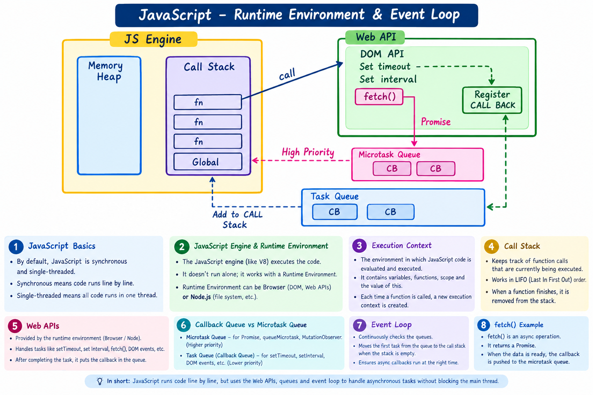

# JavaScript Runtime Environment & Event Loop

This diagram explains how JavaScript works with the runtime environment to handle asynchronous operations.

## Key points

- **Synchronous:** JavaScript executes synchronous statements in order.
- **Single-threaded:** JavaScript runs one piece of JavaScript work at a time on the main thread.
- **JavaScript engine:** Executes JavaScript code and manages the call stack.
- **Runtime environment:** Browser or Node.js APIs provide features such as timers and network requests.
- **Execution context:** The environment in which JavaScript code is evaluated.
- **Call stack:** Tracks active function calls.
- **Microtask queue:** Promise reactions are scheduled here and generally run before the next task.
- **Task queue:** Timer callbacks and other tasks wait here until they can run.
- **Event loop:** Coordinates when queued work can run after the current JavaScript stack is clear.

> Note: This is a simplified learning diagram. Browser and Node.js runtime details can differ.
